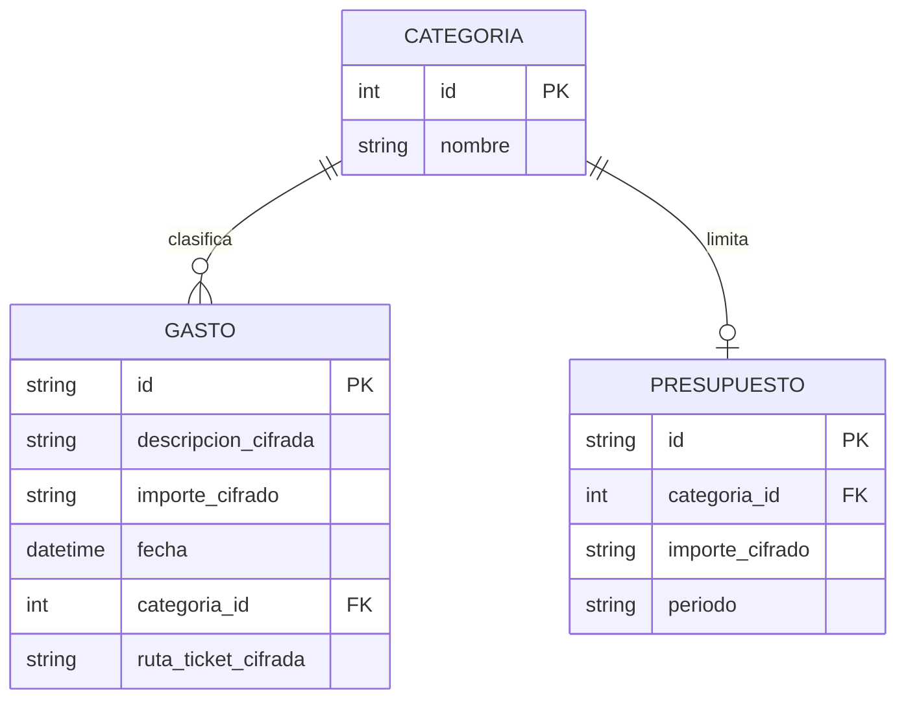

# Mis gastos — MVP Flutter

Aplicación móvil para registrar gastos personales, fotografiar tickets, crear límites semanales y revisar el gasto por categoría. Funciona sin conexión; autenticación y sincronización se habilitan con Supabase.

## Requisitos

- Flutter estable (3.27 o superior) y Dart incluidos con Flutter.
- Android Studio/SDK para Android, o Xcode en macOS para compilar iOS.
- Proyecto de Supabase solo si se requiere autenticación y sincronización en la nube.

## Instalación y ejecución

```powershell
flutter pub get
flutter run
```

Sin configuración de nube, pulsa **Continuar sin cuenta**. Los gastos y presupuestos se guardan en SQLite en el dispositivo.

Para activar registro, inicio de sesión y sincronización, crea un proyecto Supabase, aplica el SQL de la siguiente sección y ejecuta:

```powershell
flutter run `
  --dart-define="SUPABASE_URL=https://TU-PROYECTO.supabase.co" `
  --dart-define="SUPABASE_ANON_KEY=TU_CLAVE_ANON"
```

Usa únicamente la clave pública `anon`/publishable de Supabase en la app; nunca compiles una `service_role` key. Activa confirmación de correo en Supabase si quieres verificar nuevas cuentas.

### Esquema y políticas de Supabase

Ejecuta este SQL en el editor de SQL de Supabase. Row Level Security restringe lecturas y cambios al usuario autenticado:

```sql
create table if not exists public.expenses (
  id text not null,
  user_id uuid not null references auth.users(id) on delete cascade,
  title text not null,
  amount numeric(12, 2) not null check (amount > 0),
  date timestamptz not null,
  category_id integer not null check (category_id between 1 and 5),
  primary key (user_id, id)
);

create table if not exists public.budgets (
  id text not null,
  user_id uuid not null references auth.users(id) on delete cascade,
  category_id integer not null check (category_id between 1 and 5),
  amount numeric(12, 2) not null check (amount > 0),
  period text not null check (period = 'weekly'),
  primary key (user_id, id),
  unique (user_id, category_id)
);

alter table public.expenses enable row level security;
alter table public.budgets enable row level security;

create policy "Users manage their expenses"
  on public.expenses for all to authenticated
  using (auth.uid() = user_id)
  with check (auth.uid() = user_id);

create policy "Users manage their budgets"
  on public.budgets for all to authenticated
  using (auth.uid() = user_id)
  with check (auth.uid() = user_id);
```

Al sincronizar, la app aplica primero eliminaciones pendientes, sube los cambios locales y después importa las filas remotas del usuario. Mantén activas las políticas RLS; la `anon` key no sustituye las políticas.

## Funcionalidad

- CRUD de gastos, agrupación por fecha, categorías predeterminadas y validación de descripción e importe.
- Presupuestos semanales por categoría y aviso local al alcanzar el 80%.
- Recordatorio semanal programado para revisar los presupuestos.
- Cámara para fotografiar tickets; el archivo se cifra antes de persistirse.
- Inicio de sesión/registro con Supabase Auth y sincronización REST autenticada.
- Panel mensual, gráfico semanal y experiencia local sin conexión.

## Modelo de datos



La base SQLite local se crea automáticamente con las categorías iniciales y claves foráneas habilitadas. El esquema relacional se compone de `categories`, `expenses` y `budgets`.

## Seguridad y privacidad

- Importes, descripciones y rutas de tickets en SQLite se cifran con AES-256-GCM. La clave aleatoria de 256 bits se almacena con `flutter_secure_storage` en el almacén seguro del sistema operativo.
- Los bytes de cada imagen de ticket también se cifran con AES-256-GCM antes de guardarse en el directorio privado de la app. Cada cifrado genera un nonce nuevo y se valida su etiqueta de autenticación al descifrar.
- Supabase gestiona las sesiones y tokens; la app usa el cliente oficial, HTTPS y la clave pública. No guarda contraseñas ni tokens manualmente.
- RLS separa las filas remotas por `auth.uid()`. Los datos enviados a Supabase se transmiten por TLS; el servidor recibe los campos descifrados para permitir su uso en otros dispositivos.
- Los formularios validan correo, longitud de descripción, límites numéricos e importes finitos positivos.

**Alcance del MVP:** la clave local es específica del dispositivo y no se sincroniza. Las fotos de tickets se mantienen locales; gastos y presupuestos sí se sincronizan. El orden de sincronización es local primero y remoto después, por lo que, en caso de conflicto, la fila local que se envía al inicio prevalece. El dispositivo queda vinculado a la primera cuenta que inicia una sincronización para impedir mezclar datos al cambiar de usuario.

## Librerías de terceros

`sqflite` (SQLite), `supabase_flutter` (Auth/REST), `cryptography` (AES-GCM), `flutter_secure_storage`, `image_picker` (cámara), `flutter_local_notifications` + `flutter_timezone`, `fl_chart`, `intl` y `path_provider`.

## Verificación

```powershell
flutter analyze
flutter test
```

Para generar un APK de depuración:

```powershell
flutter build apk --debug
```

## Control de versiones y revisión

El repositorio público mantiene las ramas `main`, `develop`, `feature/gastos`, `feature/login` y `hotfix/budget-category-edit`, con 19 commits significativos. El PR [#1 de `feature/login` hacia `develop`](https://github.com/jonathan24-sou/Gestion-Gastos-Personales/pull/1) incluye la auto-revisión documentada en [`docs/revision-feature-login.md`](docs/revision-feature-login.md). `flutter analyze` y `flutter test` pasan; no se generó APK porque el entorno de desarrollo no cuenta con Android SDK.
